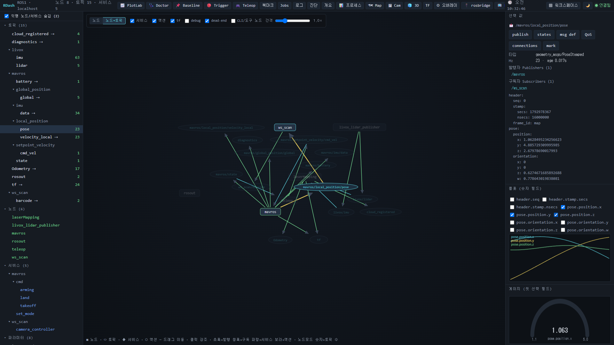
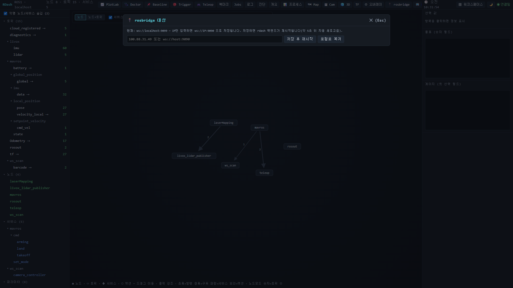
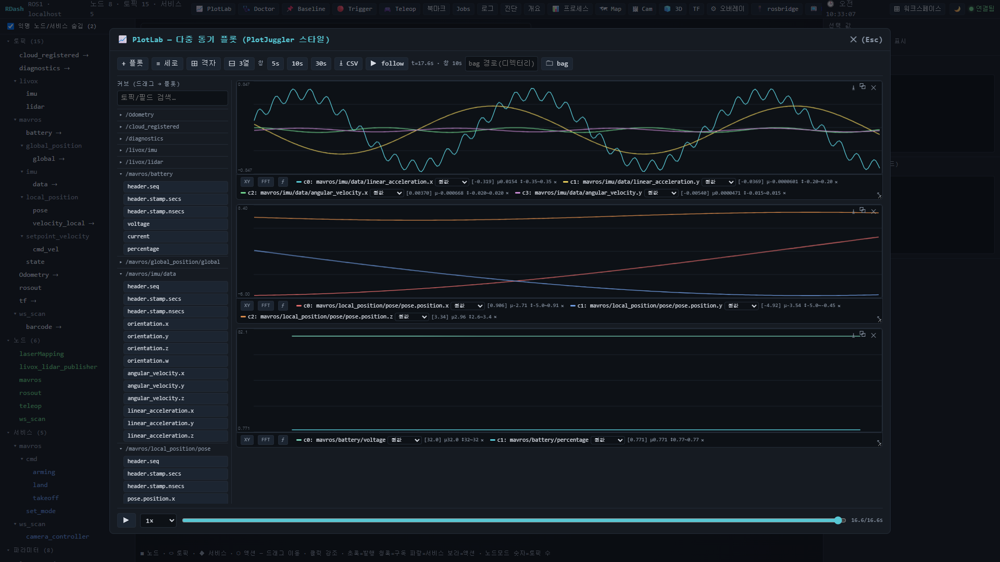
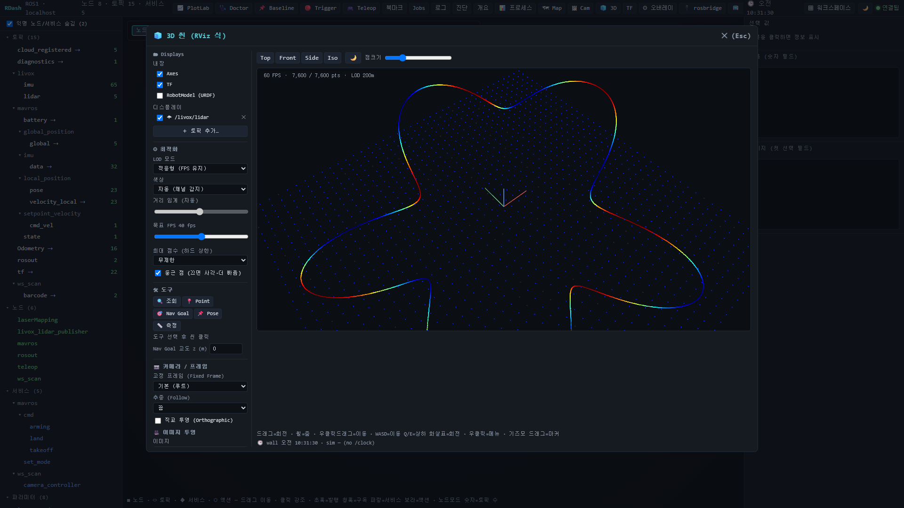
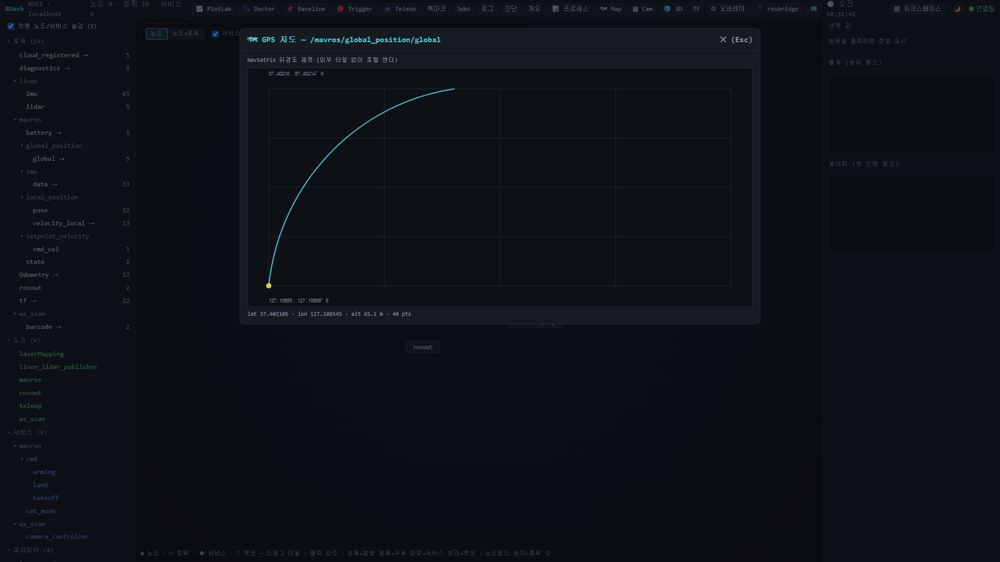
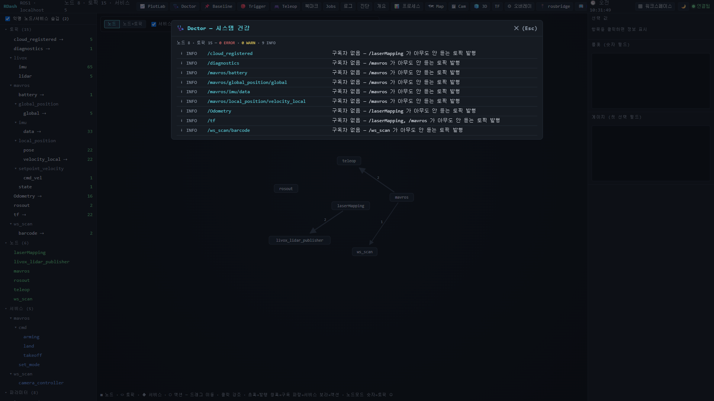

# RDash

브라우저에서 보는 **ROS1 / ROS2 대시보드**. 노드·토픽 그래프, 실시간 값·플롯, 3D 포인트클라우드, GPS 지도, 그래프 자동 진단까지 한 화면에서 본다.
로봇(보드)에는 `rosbridge_server` 만 떠 있으면 되고, RDash 는 내 PC(Windows 포함)에서 돌린다.

> rqt_graph + rqt_topic + PlotJuggler + RViz 일부를 웹 하나로 묶은 것에 가깝다. X11·Qt 없이 브라우저만 있으면 된다.



## Quick Start

```
npm install
run.cmd          # Windows
sh run.sh        # Linux
```

→ http://localhost:8080 을 연다. 툴바 **🔌 rosbridge**(단축키 `R`)에서 보드 IP 를 넣으면 붙는다.

`run.cmd` / `run.sh` 는 백엔드(`node backend/server.js`)를 재시작 루프로 돌린다. rosbridge 대상을 바꾸면 백엔드가 스스로 종료하고 루프가 새 대상으로 다시 띄운다.

### 보드 쪽 준비

보드에서 rosbridge 가 9090 으로 떠 있어야 한다.

```bash
# ROS1
roslaunch rosbridge_server rosbridge_websocket.launch
# ROS2
ros2 launch rosbridge_server rosbridge_websocket_launch.xml
```

커스텀 메시지(예: `livox_ros_driver2/CustomMsg`)를 보려면 rosbridge 를 띄우는 셸에서 해당 워크스페이스 `devel/setup.bash` 까지 source 되어 있어야 한다.

## rosbridge 대상 전환



- IP 만 넣으면 `ws://IP:9090` 으로 저장된다. `ws://host:port` 를 그대로 넣어도 된다.
- **저장 후 재시작** — 백엔드가 재시작되고 약 5초 뒤 페이지가 자동 새로고침된다.
- **로컬로 복귀** — 저장값을 지우고 기본값(`ws://localhost:9090`, ROS2 는 `9091`)으로 돌아간다.
- 저장 위치는 `~/.rdash_rosbridge_url` 이고, 환경변수 `RDASH_ROSBRIDGE_URL` 보다 우선한다.
- 헤더 왼쪽에 `ROS1 · <접속 호스트>` 가 표시된다.

## 화면 구성

| 영역 | 내용 |
|---|---|
| 헤더 | ROS 버전·접속 호스트, 노드/토픽/서비스 수, 툴바, 시계, ▦ 워크스페이스, 🌙 테마, 연결 상태(연결됨 / 재연결 중 / 끊김) |
| 왼쪽 트리 | 토픽·노드·서비스·파라미터를 `/` 단위로 접는 트리. 토픽 옆 숫자는 실측 Hz, `⇢` 는 구독자 없음(dead-end). 익명 CLI 노드 숨김 체크박스 |
| 가운데 그래프 | rqt_graph 식 노드 그래프 (아래 설명) |
| 오른쪽 인스펙터 | 선택 항목 정보·실시간 값·미니 플롯·게이지 |

### 노드 그래프

- **노드** / **노드+토픽** 두 모드. 노드+토픽 모드는 토픽을 타원으로 따로 그려 발행(초록)·구독(청록) 엣지를 보여준다.
- 서비스는 파란 마름모, 액션은 보라 육각형.
- 필터: 서비스 / 액션 / tf / debug(`/rosout` 등) / dead-end / CLI·도구 노드(`rostopic_*` 같은 익명 노드, 기본 숨김).
- 휠 줌, 빈 곳 드래그 팬, 노드 드래그, 클릭 강조, 엣지 호버 시 토픽 목록. **간격** 슬라이더로 노드 사이를 벌린다.

### 인스펙터

트리나 그래프에서 무엇이든 클릭하면 오른쪽에 바로 나온다.

- **토픽** — 타입, Hz·age, 발행자/구독자(클릭하면 이동), 실시간 메시지 값.
  버튼: `publish`(필드 폼) · `states`(값 전이 타임라인) · `msg def` · `QoS` · `connections` · `mark`.
- **플롯 (숫자 필드)** — 메시지의 숫자 필드를 체크하면 바로 아래 미니 플롯에 그려진다. 첫 번째로 고른 필드는 **게이지**에도 나온다.
- **노드** — 발행/구독 토픽 목록, kill·재시작, 파라미터.
- **서비스** — 제공 노드, 요청 인자를 넣어 call.
- **파라미터** — 현재 값, 바로 set.

선택 상태에서 쓰는 키: `m` msg def · `Q` QoS · `c` connections · `o` 노드 파라미터 · `x` 동작(publish / call / kill / set).

## 툴바

괄호 안은 단축키. 입력창에 포커스가 없을 때 동작한다. `Esc` 로 창을 닫는다.

| 버튼 | 기능 |
|---|---|
| 📈 PlotLab (`E`) | PlotJuggler 식 다중 플롯 |
| 🩺 Doctor (`H`) | 그래프 자동 진단 |
| 📌 Baseline (`K`) | 정상 상태 저장 후 현재와 비교 |
| 🔴 Trigger (`A`) | 조건 충족 시 자동 스냅샷 / rosbag |
| 🎮 Teleop (`g`) | 키보드로 Twist 발행 |
| 북마크 (`b`) | 자주 쓰는 셸 명령 저장·실행 |
| Jobs (`J`) | 실행 중인 작업(rosbag·북마크 명령 등) 출력 보기·종료 |
| 로그 (`L`) | `/rosout` 실시간 로그, 레벨·문자열 필터 |
| 진단 (`v`) | `/diagnostics` 상태별 묶음 |
| 개요 (`O`) | 노드 CPU/RSS + 토픽 Hz + stale 요약 |
| 📊 프로세스 (`P`) | 노드별 CPU% / RSS / 스레드, kill·재시작 |
| 🗺 Map (`M`) | NavSatFix 위경도 궤적 |
| 🖼 Cam (`I`) | 카메라 이미지 (+ 검출 박스·CameraInfo 오버레이) |
| 🧊 3D (`C`) | RViz 식 3D 씬 |
| TF (`t`) | TF 트리 |
| ⚙ 오버레이 (`W`) | source 할 ROS 워크스페이스 선택 (커스텀 메시지 타입용) |
| 🔌 rosbridge (`R`) | 접속 대상 전환 |
| 📺 RTSP (`V`) | RTSP 카메라 플로팅 플레이어 |

### 📈 PlotLab



- 왼쪽 커브 목록에서 토픽을 펼치고 필드를 **클릭**(마지막 플롯에 추가)하거나 원하는 플롯으로 **드래그**한다.
- `+ 플롯` 으로 플롯 추가, `≡ 세로` / `⊞ 격자` / `⊟ 3열` 배치, 각 플롯은 ⤡ 모서리로 크기 조절, ⧉ 로 별도 창 분리.
- 모든 플롯이 **시간축과 커서를 공유**한다. 휠 줌, 드래그 팬, `follow` 로 최신 따라가기 / 멈춤, 창 길이 5·10·30초.
- 아래 **스크럽 바**로 버퍼에 쌓인 구간을 되감아 재생(0.25~4배속).
- 커브별 변환: 원값, n차 미분·적분, |x|, 이동평균. 플롯별 **FFT**, **XY**(위상 플롯), **ƒ 수식 커브**(`c0-c1`, `Math.hypot(c0,c1)` 등).
- 커브마다 현재값·평균·범위 표시. `⭳ CSV` 로 전체 내보내기, 플롯별 PNG 저장.
- `bag 경로` + `🗀 bag` 으로 rosbag 을 불러와 스크럽 바로 재생.

### 🧊 3D 씬



- 왼쪽 **Displays** 패널에서 `+ 토픽 추가…` 로 여러 토픽을 동시에 띄우고, 체크박스로 숨기면 구독도 끊긴다.
- **PointCloud2** 와 **livox `CustomMsg`** 는 rosbridge 로 직접 받는다. 색상은 높이 / intensity / RGB / 단색 자동 감지.
- 점이 많으면 서버에서 솎고(`RDASH_CLOUD_MAXN`, 기본 30000점/프레임), 화면에서는 거리 기반 LOD 로 FPS 를 유지한다(적응형 / 거리 / 끔).
- 카메라: Top / Front / Side / Iso 프리셋, 드래그 회전·휠 줌·우클릭 이동, WASD 이동, 고정 프레임, Follow, 직교 투영.
- 도구: 점 조회, Publish Point(`/clicked_point`), Nav Goal(`/goal_pose`), Pose Estimate(`/initialpose`), 거리 측정.
- Marker(Array), TF 축, LaserScan·Path·Odometry·PoseStamped·OccupancyGrid, URDF RobotModel, 인터랙티브 마커, 카메라 이미지 투영도 그린다 — 이것들은 백엔드 호스트의 파이썬 브리지를 쓴다([원격 접속 시 제약](#원격-접속-시-제약) 참고).

### 🗺 Map



`sensor_msgs/NavSatFix` 토픽의 위경도 궤적을 그린다. 외부 지도 타일 없이 로컬에서 렌더링하므로 인터넷이 없어도 된다. 아래에 현재 위도·경도·고도와 점 수가 나온다.

### 🩺 Doctor



현재 그래프를 한 번에 진단해 심각도순으로 보여준다. 항목을 클릭하면 그 토픽으로 이동한다.

- QoS reliability / durability 불일치 (ROS2)
- 멈춘(stale) 토픽
- 구독자 없는 발행 (dead-end), 발행자 없는 구독

### 📌 Baseline · 🔴 Trigger

- **Baseline** — "정상일 때" 노드 목록·토픽 Hz·서비스를 저장해 두고, 다시 열면 현재와 비교해 사라진 노드, 없어진 토픽, 떨어진 발행 주기를 표시한다. `~/.rdash_baseline.json` 에 저장되며 TUI 와 공유한다.
- **Trigger** — 무장해 두면 그래프 ERROR 나 `/diagnostics` ERROR 가 생겼을 때 표시한 토픽을 자동으로 스냅샷 / rosbag 으로 남긴다(쿨다운 있음).

### 🎮 Teleop

D-pad 또는 WASD·방향키로 속도 명령을 10Hz 로 발행한다. 선속도·각속도 조절 가능.
대상 프리셋: turtlesim(`/turtle1/cmd_vel`), diff-drive(`/cmd_vel`), MAVROS(`/mavros/setpoint_velocity/cmd_vel`, `TwistStamped`), 직접 입력. cmd_vel 토픽과 메시지 타입(`Twist` / `TwistStamped`)은 자동 감지한다.

### 📺 RTSP

RTSP 카메라 주소를 넣으면 백엔드가 ffmpeg 로 fMP4 로 바꿔 브라우저에서 재생한다. 드래그·리사이즈 되는 플로팅 창이고, PiP·팝업 창 분리 후 다시 붙이기가 된다. 주소 프리셋과 저지연 모드는 저장된다. ffmpeg 는 `ffmpeg-static` 으로 같이 설치된다.

### ▦ 워크스페이스

여러 패널을 타일로 나눠 동시에 보는 화면(Foxglove 식). 패널을 오른쪽(⇥)·아래(⤓)로 쪼개고, 경계를 드래그해 크기를 바꾼다.
패널 종류: 토픽 그래프, 플롯, Raw 메시지, 이미지, 3D 씬, 진단, 로그. 패널마다 토픽을 따로 고르고, 레이아웃은 브라우저에 저장된다.

## 원격 접속 시 제약

RDash 백엔드는 ROS 그래프·메시지를 전부 rosbridge 로 받는다. 그래서 대부분 기능은 백엔드가 어디서 돌든 동작한다.

| rosbridge 만으로 동작 | 백엔드 호스트에 ROS(CLI·파이썬)가 있어야 동작 |
|---|---|
| 그래프·트리·인스펙터 값, 미니 플롯, PlotLab | 🖼 Cam (이미지 브리지) |
| Map, Doctor, Baseline, Trigger(스냅샷) | 3D 의 Marker·TF·URDF·Odometry 등 (포인트클라우드는 됨) |
| 로그(`/rosout`), 진단(`/diagnostics`) | TF 트리, msg def, 대역폭 |
| publish, 서비스 call, Teleop | 📊 프로세스 (백엔드 호스트의 `ps` 를 본다) |
| ROS1 파라미터 조회·설정, 노드 kill | rosbag 녹화·재생, 북마크 명령 (백엔드 호스트에서 실행) |
| 3D 포인트클라우드, RTSP | |

오른쪽 기능까지 쓰려면 RDash 를 보드(ROS 가 도는 기기)에서 직접 띄우고, 브라우저로 `http://<보드 IP>:8080` 에 접속한다.

## TUI

같은 백엔드를 쓰는 터미널 UI 도 있다. SSH 로만 붙을 수 있을 때 쓴다.

```bash
npm start      # TUI + 웹 백엔드를 함께 띄움
```

```
╭ RDash        102 ╮ ╭ /iris/imu [topic] 99Hz            3-20/45 ↕ ╮
│ ▶ services       │ │ header:                                     │
│ ▶ params         │ │   stamp: {...}                              │
│ ▼ topics         │ │ orientation:                                │
│   ▶ mavros       │ │   x: 0.0012  y: -0.003 ...                  │
│   ● /iris/imu 99 │ │ angular_velocity: ...                       │
│ ▶ nodes          │ │                                             │
╰──────────────────╯ ╰─────────────────────────────────────────────╯
 ↑↓ move | Enter select | p plot | c conn | t tf | b marks | ? help | q quit
```

**원격 rosbridge 접속** — `D` 를 누르면 ROS 환경 창에 rosbridge 대상 입력칸이 나온다. 웹과 똑같이 IP 만 넣고 Enter 하면 `ws://IP:9090` 으로 저장되고 백엔드가 새 대상으로 재시작된다. 비우고 Enter 하면 로컬로 돌아간다. 현재 대상은 상단 환경 줄에 `rb:<host:port>` 로 표시된다. 시작할 때부터 지정하려면 `RDASH_ROSBRIDGE_URL=ws://IP:9090 npm start`.

ROS 가 없는 PC(Windows 등)에서 띄울 땐 `RDASH_NO_AUTOPIP=1` 로 파이썬 패키지 자동 설치를 끈다.

| 키 | 동작 |
|---|---|
| `↑↓` / `j` `k` | 이동 |
| `Enter` / 클릭 | 펼침 · 선택 |
| `/` | 트리 퍼지 검색 (`Esc` 해제) |
| `x` | 선택 항목 동작: 토픽 publish(필드 폼) / 서비스 call / 노드 kill / 파라미터 set |
| `b` / `1`-`9`,`0` | 북마크 관리 / 바로 실행 |
| `J` | 작업(Jobs) |
| `w` | 워치리스트 (여러 토픽 필드 고정) |
| `F` | 프리플라이트 체크 (`~/.rdash_preflight.json`) |
| `c` / `n` | 연결(pub/sub) / 노드 그래프 |
| `t` / `T` / `S` / `O` | TF 트리 / 두 프레임 tf echo / 노드 리소스 / 시스템 개요 |
| `L` / `v` | 로그 / 진단 |
| `m` / `Q` / `y` | 메시지 정의 / QoS / 이름 복사(OSC52) |
| `o` / `V` | 파라미터 튜닝(ROS2) / 라이프사이클(ROS2) |
| `H` / `K` / `A` | Doctor / Baseline / Trigger 무장 |
| `W` | Teleop (WASD) |
| `.` / `X` | 토픽 표시 / 표시 토픽 스냅샷 |
| `R` / `P` / `B` | rosbag 녹화 / 재생 / A·B 비교 |
| `h` | Hz 측정 모드: all / selected / off |
| `D` | ROS 환경 보기 · rosbridge 대상 전환 |
| `Tab` | 트리 숨김 (값 전체폭) |
| `space` | 값 프리즈 |
| `[` `]` / `g` `G` / `+` `-` | 값 스크롤 / 맨위·맨아래 / 렌더율 |
| `?` / `q` | 도움말 / 종료 |

## 설정 (환경변수)

| 변수 | 기본값 | 의미 |
|---|---|---|
| `RDASH_ROSBRIDGE_URL` | `ws://localhost:9090` (ROS2 `9091`) | rosbridge 주소. UI 에서 저장한 `~/.rdash_rosbridge_url` 이 더 우선 |
| `RDASH_WEB_PORT` | `8080` (ROS2 `8082`) | 웹 포트 |
| `RDASH_WEB_HOST` | `0.0.0.0` | 바인딩 주소. `127.0.0.1` 이면 로컬 전용 |
| `ROS_VER` | 자동 | `1` 또는 `2` 강제 |
| `RDASH_CLOUD_MAXN` | `30000` | 3D 클라우드 프레임당 최대 점 수 |
| `RDASH_API` | — | TUI 가 백엔드를 띄우지 않고 이미 떠 있는 백엔드(`http://host:8080`)에 붙음 |
| `RDASH_NO_AUTOPIP` | `0` | `1` 이면 시작 시 파이썬 패키지 자동 설치 안 함 |
| `RDASH_NO_AUTOAPT` | `0` | `1` 이면 rosbridge_server apt 자동 설치 안 함 |
| `RDASH_LOOPBACK` | `1` | `0` 이면 ROS1 `ROS_IP=127.0.0.1` 강제를 끔 (다른 머신의 마스터에 붙을 때) |
| `RENDER_HZ` | `10` | TUI 최대 화면 갱신율 |
| `RDASH_MOUSE` / `RDASH_DIFF` | `1` | TUI 마우스 / 줄 단위 차등 렌더 |

컨테이너 안에서 돌리면 `-p 8080:8080` 이나 `--network host` 로 포트를 열어야 호스트에서 접속된다.

## 파일

- `~/.rdash_rosbridge_url` — 저장된 rosbridge 대상
- `~/.rdashrc` — 북마크
- `~/.rdash_baseline.json` — Baseline 프로파일 (웹·TUI 공유)
- `~/.rdash_preflight.json` — 프리플라이트 체크 정의
- `~/.rdash_session.json` — TUI 세션 상태
- `rdash_rec_<ts>` / `rdash_snapshot_<ts>.txt` — rosbag 녹화 / 값 스냅샷

## 구조

```
frontend/tui/  ─┐
                ├─ HTTP + /ws ─▶ backend/ ─▶ rosbridge ─▶ ROS
frontend/web/  ─┘
```

웹과 TUI 는 둘 다 백엔드 API(`API.md`)의 클라이언트이고, ROS 에 붙는 건 백엔드 하나다. 브라우저 연결은 `/ws` 하나로 다중화되며, 포인트클라우드는 바이너리 프레임(float32 `xyzc`)으로 보낸다.

```
index.js       TUI 진입점 — 백엔드를 띄우고 응답을 기다린 뒤 렌더
shared/        TUI·백엔드 공용 — ROS 명령 빌더, rosbridge 클라이언트, 포트·경로
backend/       백엔드(node backend/server.js) + python/ 센서 브리지
frontend/tui/  React Ink TUI
frontend/web/  브라우저 UI — 네이티브 ES 모듈, 빌드 단계 없음
```

자세한 구조와 검증 방법은 `ARCHITECTURE.md`.

## 테스트

```bash
node test/test_cloud.mjs                        # 클라우드 디코더 단위 테스트
bash test/test_turtlesim.sh                     # ROS1 데모 데이터
bash test/test_ros2.sh                          # ROS2 데모 데이터
for f in $(find . -name '*.js' -not -path './node_modules/*'); do node --check "$f"; done
```

## License
MIT
